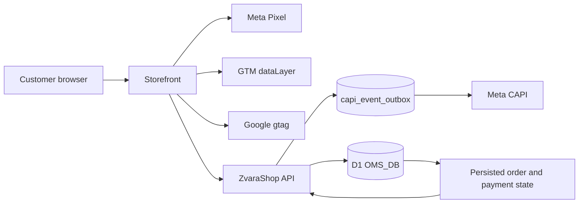

# ZvaraShop Meta Pixel, CAPI, GTM, and Google Ads Specification

> Verified against disk: 2026-09-04 @ `81e2031` + open-gap audit working tree

This document owns the technical tracking contract for ZvaraShop-rendered and
headless storefronts. It covers event semantics, identity, browser/server
boundaries, deduplication, durable delivery, store configuration, and
verification. It does not claim attribution certainty, legal compliance,
consent applicability, or live provider acceptance.

ZvaraShop is **one Worker = one store** ([`ARCHITECTURE.md`](./ARCHITECTURE.md),
[`DECISIONS.md`](./DECISIONS.md) ADR-001/ADR-024), so “store configuration”
below means the single `stores` row, resolved D1-first with environment fallback.

## 1. Architecture



The storefront owns browser tag loading and event presentation. ZvaraShop owns tracking configuration, public payload validation, canonical catalog/order identity, Purchase qualification, durable CAPI delivery, and server CAPI credentials.

A headless storefront may use a different framework and design, but it must not fork event meaning, product identity, or Purchase qualification.

## 2. Current Implementation Boundary

### Implemented in ZvaraShop-rendered routes

- `MetaPixelBase.astro` resolves a valid Pixel ID from D1 with environment fallback, and owns the **single** `fbq('init')` (§4a) plus `window.__PS_LOAD_META_PIXEL__`.
- `GtmBase.astro` resolves and validates the GTM container ID.
- `GoogleAdsBase.astro` resolves a complete Google Ads conversion ID/label pair, emits the region-scoped Consent Mode v2 defaults (§10), and exposes `window.__PS_PUSH_GOOGLE_CONVERSION__`.
- Page, product, landing, and thanks trackers emit the supported browser events.
- `/api/meta-event` accepts only supported event names and validates event ID, same-origin source URL, product/value payload, and bounded customer data before enqueueing to the CAPI outbox.
- `/api/v1/tracking/events` provides the same contract for headless storefronts behind developer-API-key auth (§12).
- `src/lib/capi-outbox.ts` records every CAPI event in D1 before transmission and retries failures (§11).
- Click identifiers are captured in middleware into a first-party cookie and persisted on the order (§7).
- `/admin/ads/meta` manages Pixel ID plus masked CAPI readiness and supports an explicit Test Events request.
- `/admin/ads/google` manages GTM independently and validates the Google Ads conversion pair.
- `/thanks` gates Purchase from recorded order/payment state and uses browser duplicate guards.

### Headless storefront bootstrap — what ships and what does not

`src/pages/api/v1/storefront.ts` **ships** a storefront bootstrap endpoint. `GET /api/v1/storefront` returns store identity, home content, payment capability (COD flag, COD-disabled province codes, supported methods), and a `tracking` block containing exactly four non-secret identifiers:

- `meta_pixel_id`
- `google_ads_conversion_id`
- `google_ads_conversion_label`
- `google_tag_manager_id`

`meta_capi_token` is never in the response. It is not a keyless public endpoint: `validateHeadlessRequest()` requires a developer API key via `X-App-Key`, `X-Api-Key`, or `Authorization: Bearer`, verifies it against `developer_api_keys` (SHA-256 lookup plus secret verification, revoked keys rejected), and then enforces the origin allowlist.

Genuinely not yet implemented:

- a **keyless** public bootstrap for storefronts that cannot hold a server-side key;
- a framework-neutral tracking adapter package;
- a completed cross-storefront consent adapter;
- automated verification across every external storefront repository.

Do not expose `meta_capi_token` to solve the keyless-bootstrap gap. See [`STOREFRONT_INTEGRATION.md`](./STOREFRONT_INTEGRATION.md) for the planned adapter boundary.

## 3. Store Configuration

`getStoreAdsConfig(locals)` resolves:

- `meta_pixel_id` and `meta_capi_token`;
- `google_tag_manager_id`;
- `google_ads_conversion_id` and `google_ads_conversion_label`.

D1 values take precedence over environment fallback. Changes in Ads & Tracking apply to subsequent requests without rebuilding the Worker.

Security rules:

- CAPI tokens and webhook secrets are never returned by read APIs;
- blank token submissions preserve the active secret;
- Google Ads conversion ID and label are both present or both absent;
- browser configuration may contain only non-secret identifiers;
- isolation between stores is the deployment boundary — a second store is a second install with its own D1 and its own credentials, not a scope column.

## 4. Canonical Event Semantics

| Meta event | GTM event | Browser trigger | Qualification |
| --- | --- | --- | --- |
| `PageView` | `page_view` | Eligible page load | Tag and consent state permit browser tracking. |
| `ViewContent` | `view_item` | One canonical product is viewed | Canonical D1 product ID and current D1 value. |
| `AddToCart` | `add_to_cart` | Current direct-response form reaches qualified customer intent | Never a scroll, impression, or arbitrary CTA click. |
| `InitiateCheckout` | `begin_checkout` | A valid checkout submit attempt begins | Product, variant, value, and customer boundary have passed browser validation; server still revalidates. |
| `Purchase` | `purchase` | The qualifying persisted order state is confirmed | COD requires persisted order success; online payment requires authenticated paid reconciliation, which itself enqueues the server CAPI Purchase (same `INV-` event id, so a browser leg that already fired is a no-op) for buyers who never return to `/thanks`. |

`src/lib/meta-event-contract.ts` accepts exactly these five names. The repository does not map every interaction to `Lead` or `Purchase`. Analytics UI events must remain separate from optimization events.

## 4a. One `fbq('init')` per page, and who owns it

`fbevents.js` honours `fbq('init', pixelId, advancedMatching)` for a given Pixel
ID **exactly once** and silently ignores every later call. Verified against the
live library on 2026-08-28: after a second
`fbq('init', id, { ph, fn, ct })`, `fbq.instance.pixelsByID[id].userData` still
held only the `{ external_id }` the first init had set.

Consequences, which are contract rather than style:

- `MetaPixelBase.astro` is the **only** file permitted to call `fbq('init')`.
  `meta-identity.test.ts` fails if any other tracking source calls it.
- A page that knows the visitor's identity at bootstrap time declares
  `window.__PS_META_AWAIT_MATCHING__ = true` **before** `MetaPixelBase` runs —
  `BaseLayout` renders `<slot name="head" />` ahead of it, which is the only
  window in which that is possible — and then calls
  `window.__PS_META_INIT__(advancedMatching)` once its SHA-256 hashes are ready.
  `/thanks` is currently the only such page. A 1500 ms timer in the base is the
  backstop, so a tracker that bails out (no order state, `?preview=1`) still
  costs nothing but its advanced matching.
- Identity discovered **after** bootstrap cannot reach the browser leg at all.
  The checkout forms therefore send late identity to the CAPI leg only, under
  the same `event_id`; they no longer re-init the Pixel.
- No other file may call `fbq('track')` either. They call
  `window.__PS_META_TRACK__(eventName, data, options)`, which `MetaPixelBase`
  installs and which holds each call until the single `init` has actually been
  **issued** — see §4b.

### 4b. Why tracking is queued behind the init, and not merely after it

Calling `__PS_META_INIT__` and *issuing* the init are two different moments.
The init waits on the external-ID SHA-256, so the function returns and the
`fbq('init')` lands a microtask later. `fbq`'s own stub queues by arrival order
and `fbevents.js` replays that queue in the same order, which makes the gap
load-bearing rather than cosmetic.

Measured against the live library on 2026-09-04, in an isolated frame, with a
clean stub and no other difference than call order:

| Order handed to `fbq` | Beacons to `facebook.com/tr` |
| --- | --- |
| `track` then `init` | **0** |
| `init` then `track` | 1 |

A `track` replayed ahead of the init is discarded. Nothing throws and nothing
appears in Events Manager — the event simply never existed.

`MetaViewContentTracker` and `MetaLandingTracker` fire during body parse, while
that digest is still outstanding. `astro.config.mjs` sets
`build.inlineStylesheets: 'always'`, so no render-blocking stylesheet separates
them from the head bootstrap and nothing guarantees the parser yields in
between: replaying both inline scripts in a single tick puts `ViewContent`
ahead of the init every time, while a production page with a chunk boundary
between head and body may well win the race. The outcome was decided by network
timing, and the losing side lost the event silently — the CAPI twin kept
arriving, so the dashboards showed a ViewContent either way.

`__PS_META_TRACK__` removes the race rather than the symptom.
`meta-pixel-ordering.test.ts` replays the real inline scripts in one tick and
fails if any `init` follows any `track`, and asserts that no tracker reaches
`fbq('track')` around the hook.

Until 2026-08-28 three files called `init` behind the bootstrap —
`MetaThanksTracker.astro`, `form-hybrid.ts` and `form-middle.ts`. Every
advanced-matching object they built was discarded, so a browser `Purchase` was
matched on `external_id` alone while the CAPI leg for the same order carried
`ph`, `fn`, `ln`, `ct`, `st`, `zp`, `country` and `external_id`. Nothing errored;
the Pixel kept firing and reported no problem.

`client_user_agent` was also being sent in that object. It is a Conversions API
field, not a Pixel match key: the live library stores it on `userData` with no
`censoredUserDataFormat` entry, i.e. it counts for nothing. The CAPI leg derives
the user agent at the request boundary (§ "Request-derived context").

### The conversion never waits on the deferral timer

`fbevents.js` is deferred to first interaction or 2500 ms. On `/thanks` the
first interaction is the WhatsApp hand-off, so a `Purchase` queued in the `fbq`
stub can lose the race with the buyer leaving. `MetaPixelBase.astro` therefore
exposes `window.__PS_LOAD_META_PIXEL__`, which `MetaThanksTracker.astro` calls
as soon as it knows it is on a confirmation page — the same escape hatch
`__PS_LOAD_GOOGLE_TAG__` has always provided for the Google leg (§10). Measured
on the real library: the request moved from 2522 ms to 45 ms.

## 5. Product Catalog Identity

Every product event carries the **catalog item id** in `content_ids`: the
immutable D1 Product ID as a bare decimal string with no leading zero and at
least five digits, for example `78981`. That is the same string the Google and
Meta feeds publish as `<g:id>`, and it has to be byte-identical or Advantage+ and
Dynamic Product Ads match nothing — silently, with no error and no diagnostic
anywhere.

**The catalog is product-level.** One catalog item per product; a variant is a
checkout choice and never a separate catalog identity. `ViewContent`,
`AddToCart`, `InitiateCheckout` and both Purchase legs therefore all send the
same product id, whether or not a variant has been picked. The variant id stays
on the order for fulfilment and reporting and is never folded into `content_ids`.
For Purchase, this identity is re-read from the persisted order relationship
(`order_items → product_variants → products`) after the order token is verified.
The browser's stored product id is only initial state; both the Pixel payload
and CAPI payload are replaced by the D1-derived `content_ids` before dispatch.
An order whose product relationship cannot be resolved emits no browser
Purchase and the server omits `content_ids` rather than trusting or guessing a
caller-supplied value.

`catalogProductId()` in `src/lib/catalog-feed.ts` is the single implementation,
and it **fails closed**: an id that is not `^[1-9]\d{4,15}$` throws rather than
being padded into a value that is no longer the real Product ID.
`catalog-identity.test.ts` asserts the invariant by checking the feed output
against what the trackers send — the two halves against each other, never each
against its own fixture, because separate fixtures are exactly how three
different values passed CI once before.

Catalog copy is merchant-owned. `products.brand` is emitted as `g:brand`; a
blank value falls back to the store name. `products.description` supplies feed
copy after published product presentation content and before the generic
fallback. Google output deliberately omits `identifier_exists` and does not map
merchant-editable SKU to `g:mpn`: a bundle label such as `BELI_1_PCS` is not a
manufacturer part number. A legacy product whose ID cannot satisfy the catalog
identity contract is omitted from the aggregate feed instead of returning a
500 for every valid product.

Two corrections are worth remembering, because both were invisible while live:

- Until 2026-08-17 the Pixel sent the bare row id (`1`) while both feeds
  published `10000 + id` (`10001`) and the admin screen showed the operator
  `10001`. Three values for one product, every test green, catalog retargeting
  dead.
- Until 2026-08-28 **this section** described a variant-level scheme,
  `p{product_id}-v{variant_id}` with `p{product_id}` as an `item_group_id`. No
  such string has ever been published or sent. Per `AGENTS.md` §1 the tree wins;
  the document was the bug. Do not reintroduce that scheme casually — an id that
  a feed has already published can never be changed without orphaning the
  catalog's history, so moving to a variant-level grain is a catalog
  re-creation, not an edit.

- D1 product ID: tracking and external catalog identity.
- D1 variant ID: order selection identity when variant detail is needed.
- Slug: routing label only.
- SKU: internal inventory label only.
- Frontend list index, campaign alias, provider ID, or legacy seed name: invalid tracking identity.

`ViewContent`, `AddToCart`, `InitiateCheckout`, browser Purchase, server CAPI Purchase, and any Meta Commerce Catalog integration must agree on the same product ID.

## 6. Event ID and Purchase Deduplication

### Intended contract

A funnel event and a Purchase event must not reuse one ID.

1. Create a dedicated Purchase event ID for the order attempt.
2. Return and preserve that ID with the persisted order state.
3. Browser Pixel Purchase and server CAPI Purchase use the identical string.
4. The thanks flow applies both browser guards:
   - `Purchase_' + purchaseEventId`;
   - `Purchase_order_' + orderId`.

   Each is **read** before the event is dispatched and **written** only after
   both legs have gone out. Until 2026-08-28 a single `once()` did both at the
   moment the tracker decided to fire, so a page that died inside the pixel's
   2.5 s deferral — or a browser that threw on the `localStorage` write, as
   Safari private mode does — kept the claim and lost the conversion on both
   legs, permanently. Retrying is safe because Meta deduplicates on `event_id`
   and `capi_event_outbox.event_id` is `UNIQUE`; losing a conversion is not.
   Both storage calls are now wrapped, so a refused write costs the guard, never
   the Purchase.
5. Refresh, revisit, duplicate callback, or repeated polling must not create another Purchase for the same qualifying order.
6. A new valid order receives a new Purchase event ID.

Event-ID deduplication cannot repair three business orders that were already
created from one repeated checkout: three `INV-` numbers are three legitimate
event IDs to Meta. The checkout boundary therefore also owns business replay
deduplication. It hashes the validated, server-priced checkout identity, gives
that fingerprint one live D1 owner for two hours, and returns the canonical
order for exact retries across native, middle/hybrid, and Headless callers.
The unique partial index is the concurrency guard; application pre-checks are
only the fast path. A replay does not create another notification, receiver
score, Purchase identity, or second live payment instruction for an order that
already has one. An expired or terminal claim is released so a later genuine
reorder receives a new `INV-` number.

### What ships today

All six guards hold as of 2026-08-16. Both legs key Purchase on the `INV-` order number:

| Leg | Value sent | Source |
| --- | --- | --- |
| Browser `fbq('track', 'Purchase', …, { eventID })` | the `INV-` order number | `MetaThanksTracker.astro` derives it from `order_number` in the `/api/order-status` response — the same D1 column the server leg uses — and fires nothing at all if it cannot be resolved |
| Server CAPI | the `INV-` order number | `src/pages/api/meta-event.ts` sets `eventId` from `purchaseOrder.order_number` for every `Purchase` |

The same lookup owns Purchase merchandise data: `product_value` is summed from
the stored order items and `content_ids` is derived from their immutable Product
IDs. A modified `sessionStorage`, public JSON payload, invoice total, shipping
charge, or later catalog price cannot restate either field.

Until 2026-08-16 the browser minted `purchase_<productSlug>_<random>` instead, which the server discarded — so the two legs never matched and Meta counted each Purchase twice. The fix aligned the browser onto the server's key rather than weakening the server gate, because the order-number key is what makes the server leg idempotent per order. **The correction is forward-only:** Meta deduplicates at ingestion inside a 48-hour window and offers no retroactive merge, so historical Purchase counts and values remain inflated and historical ROAS remains understated. Treat the deploy date as a reporting break, not a performance drop.

The server gate is unchanged: `/api/meta-event` requires `order_number` plus a valid `status_token` before it will emit any Purchase, and returns `404` for an unknown or mismatched token.

Server-side, `capi_event_outbox.event_id` carries a `UNIQUE` constraint and `enqueueCapiEvent()` uses `INSERT OR IGNORE`, so a replayed request returns `{ deduplicated: true }` instead of producing a second outbound conversion. Combined with the order-number key, that means one CAPI Purchase per order for all time — a durable dedupe layer above Meta's own `event_id` handling.

A local duplicate guard proves only the browser and database paths. CAPI acceptance and Meta deduplication require a separately observed provider response.

## 7. Customer Matching and Click-ID Attribution

### Hash before CAPI

Normalize and SHA-256 hash every supported customer identifier before it leaves
ZvaraShop:

- phone after Indonesian international normalization;
- a real email after trim and lowercase — never the synthetic payment-provider
  fallback used by the deliberately email-free native checkout;
- first and last name after trim and normalization;
- the stable advertiser-issued external ID described below.

Meta's current documentation is internally inconsistent: the customer-parameter
index calls `external_id` hashing recommended while the live Payload Helper calls
it required. ZvaraShop takes the privacy-safe intersection and always hashes it
on both Pixel and CAPI legs. A dashboard label that says “no hash required” is
not permission to expose the raw identifier.

### The advanced-matching key set, against Meta's own list

Verified 2026-08-28 against Meta's Pixel advanced-matching reference. The valid
manual keys are `em`, `fn`, `ln`, `ph`, `external_id`, `ge`, `db`, `ct`, `st`,
`zp`, `country`. The confirmation page sends **eight** of them —
`ph fn ln ct st zp country external_id` — which is every key this checkout
actually knows. Both legs send the same eight: until 2026-09-04 the CAPI leg
did not. `country` was validated by `meta-event-contract.ts`, hashed by
`meta-capi.ts`, posted by the `/thanks` browser leg and forwarded by the
headless route — and dropped by `/api/meta-event`, which built `user_data`
without it. That route carries every first-party PageView, ViewContent and
`/thanks` Purchase, so the Pixel leg of an order described the buyer with a
country and the CAPI leg of the same order did not. `resolveMetaCountry` now
supplies it: `id` for a resolved order, which is truthful because every order
carries an Indonesian province, is quoted in IDR and ships domestically; the
caller's validated claim otherwise; and Cloudflare's `cf-ipcountry` for the
buyer's own request as the last source. Cloudflare's `XX` and `T1` yield no key
at all — a hash of a non-country matches nobody, and Meta scores match quality
on the keys it was given. The headless route passes no edge country, because
its caller is another server whose location is not the buyer's.

The three omissions are deliberate:

- `ge` and `db` are never collected.
- `em` has no real value to send. The native checkout is email-free by design;
  the only address an order can carry is the `<phone digits>@<store host>` that
  `buyerEmail()` mints so an online payment provider has something to accept.
  That address identifies nobody, and Meta scores match quality on the keys it
  is *given*, so supplying it is worse than omitting it. `isSyntheticBuyerEmail`
  in `src/lib/meta-identity.ts` drops it at the CAPI boundary — until 2026-08-28
  it was hashed into `em` for every paid online order.

Meta's reference also settles two things this implementation depends on:
pre-hashed values are accepted (`"accept[s] both lowercase unhashed and
normalized SHA-256 hashed"`), so the SHA-256 the trackers compute is passed
through rather than hashed again; and `client_user_agent` is **not** on the list,
which is why it no longer appears in the Pixel payload.

The docs are silent on what a *second* `fbq('init')` does. That behaviour was
established against the live library instead (§4a) — which is the stronger
evidence for this particular question, and the only kind available.

### Never hash Meta browser identifiers

Preserve `_fbp` and `_fbc` exactly as issued when present. They are attribution
identifiers, not Advanced Matching fields. Do not place them in URLs or logs.

### Stable first-party external ID

`MetaPixelBase.astro` mints `adsbook_meta_external_id` only when a valid Meta
Pixel is configured. It is 128 random bits encoded as 32 lowercase hexadecimal
characters, generated with Web Crypto, and retained for 90 days. HTTPS uses
`SameSite=None; Secure` so an embedded storefront can keep the same identifier;
local HTTP uses `SameSite=Lax`.

The raw value remains first-party transport data. Pixel Advanced Matching and
the outbound CAPI payload each contain its SHA-256 hash. `PageView`,
`ViewContent`, `AddToCart`, `InitiateCheckout`, and `Purchase` therefore share
one advertiser-issued identity instead of changing `external_id` to a phone
number only after checkout. An upgrading session without the cookie temporarily
falls back to normalized phone; the next Pixel bootstrap creates the stable key.
The identifier is never accepted from a URL and never used as `event_id`. At
checkout, its validated raw first-party value is retained in the private
`orders.meta_request_context` snapshot so a paid-later Purchase can hash and
reuse the same identity after the browser request has ended.

### Request-derived context

Client IP and user agent are derived at the server boundary
(`getClientIp(request.headers)` and the `user-agent` header) rather than trusted
from arbitrary browser fields.

`external_id`, `_fbp`, and `_fbc` are derived the same way.
`readMetaBrowserIds(request)` in `src/lib/click-ids.ts` validates them from the
request cookie header. All are first-party on the storefront origin and every
tracker posts same-origin, so they arrive without a tracker having to include
them. Explicit `_fbp`/`_fbc` values still win because Meta minted them; the
dedicated external-ID cookie wins over phone so one visitor keeps one identity.

This is deliberate rather than defensive. Before the server read, `ViewContent`
and `PageView` posted no `user_data` at all, and on a live install that was 2992
of 3115 delivered events — 96% of the CAPI volume — reaching Meta with nothing
but an IP and a user agent. `fbc` was absent from all 3115, Purchases included.
The server read also holds when a browser read cannot: the pixel deferred,
blocked by an extension, or simply not loaded when the event fires. For `fbc`
specifically it falls back to the `_fbc` synthesized into the click-ID cookie by
the middleware at landing, which exists on ad traffic before the pixel runs.

`MetaPixelBase.astro` creates a valid first-party `_fbp` synchronously before
the immediate PageView/ViewContent CAPI trackers run, following the same early
parameter-builder behavior used by Meta's official integrations. The deferred
`fbevents.js` then reads that same cookie. This closes the race where the Pixel
event eventually had `fbp` but its paired server event had already been queued
without one.

Checkout also serializes the validated `external_id`, `_fbp`, `_fbc`, original
client IP, and user agent into `orders.meta_request_context` (migration `0052`).
The three native/headless order routes share this boundary. A Purchase emitted
after a later payment confirmation uses the checkout snapshot, not the
operator's IP or browser. Malformed and oversized values fail closed. Existing
orders remain valid but cannot be retroactively enriched with request data that
was never stored.

### Click identifier capture and persistence

Click-ID preservation is owned by `src/lib/click-ids.ts`, `src/middleware.ts`, and the `orders.ad_click_ids` column — **not** by `src/lib/order-schema.ts`, which carries no click-ID fields.

`CLICK_ID_KEYS` in `src/lib/click-ids.ts` is a single list covering all three families:

| Family | Keys |
| --- | --- |
| Google | `gclid`, `gbraid`, `wbraid` |
| Meta | `_fbp`, `_fbc`, `fbclid` |
| UTM | `utm_source`, `utm_medium`, `utm_campaign`, `utm_content`, `utm_term` |

Flow:

1. **Capture.** `src/middleware.ts` runs `parseClickIdsFromUrl(url)` on every non-private request. Values must match `/^[A-Za-z0-9._-]{1,256}$/` or they are dropped. When `fbclid` arrives without `_fbc`, the library synthesizes `_fbc` as `fb.1.<timestamp>.<fbclid>`.
2. **Store.** Matching values are JSON-serialized into the cookie named by `CLICK_ID_COOKIE` — currently `adsbook_click_ids` — with `Max-Age` of 90 days, `Path=/`, and `SameSite=None; Secure` on HTTPS (`SameSite=Lax` otherwise). `_fbp` and `_fbc` are additionally re-issued as their own first-party cookies so Meta's own readers find them.
3. **Read back.** `readOrderClickIds(request)` is called by `src/pages/api/submit-order.ts`, `src/pages/api/submit-middle-order.ts`, and `src/pages/api/v1/checkout.ts`; it merges the landing cookie with newer direct `_fbp`/`_fbc` cookies. `readMetaBrowserIds(request)` provides the same validated values to `src/pages/api/meta-event.ts`. Cookies ride along with the submit request, so no hidden form fields are needed. Malformed or hand-edited cookie values parse to `{}` rather than throwing inside the order path.
4. **Persist.** The serialized attribution value is written to `orders.ad_click_ids` (migration `0024_daily_typhoid_mary.sql`), while the bounded paid-later identity/request snapshot is written to `orders.meta_request_context` (migration `0052_meta_order_context.sql`). A new Google click replaces only Google identifiers and a new Meta click replaces only Meta click identifiers; neither platform erases the other's last attributable identity.
5. **Classify.** `src/lib/traffic-source.ts` reads that stored JSON and derives a `TrafficSourceType` of `meta`, `google`, `organic`, or `custom`, precedence Meta → Google → UTM heuristics. The admin surfaces it through `TrafficSourceBadge` in `OrdersTable.tsx` and `OrderDetail.tsx`.

The cookie is `adsbook_click_ids`, renamed from `zanoby_click_ids` on 2026-08-16. `readClickIdCookie()` still **reads** the legacy name when the current one is absent, so attribution captured before the rename survives; nothing writes the legacy name, so it ages out with its own 90-day expiry.

Why this matters for COD: the real conversion happens days after the click, when the courier collects cash. Without the click ID captured at landing and stored on the order, delivered revenue can never be uploaded back as an offline conversion, and Smart Bidding only ever learns from unconfirmed form submissions.

### Cross-frame and cross-page preservation

- `src/lib/checkout-navigation.ts` re-attaches all eleven tracking keys to intermediate checkout navigation URLs, reading from the current query string first and the `adsbook_click_ids` `sessionStorage` entry second. Checkout **completion** URLs are deliberately restricted to opaque order lookup values so no PII or attribution string leaks into a shareable confirmation link.
- `public/adsbook-form-widget.js` carries the parent-page logic for embedded storefronts. It syncs the same eleven keys into the iframe `src`, recovers `_fbp`/`_fbc` from parent cookies when absent from the URL, and listens for origin-checked `postMessage` events. It is served by the store, so a merchant page picks up fixes on deploy — unlike the inline variant it replaced, which froze the same logic onto the merchant's page permanently and was removed on 2026-08-16.

## 8. TikTok — removed 2026-08-24

TikTok was never a full integration — no pixel base component, no Events API, no server outbox, no `event_id` dedup — only `ttclid` click-id capture and a `tiktok` traffic-source classification for the admin order filter. `STATUS.md`'s Tracking line had drifted to describe this as "TikTok event hooks", which overstated it. Rather than leave a partial, easily-misread surface in place, `ttclid` was removed from `CLICK_ID_KEYS`, the `tiktok` branch was removed from `parseTrafficSource` (and `TrafficSourceType`), and the "TikTok Ads" filter option was removed from the admin orders UI and its API. `orders.ad_click_ids` on rows captured before this keeps whatever `ttclid` it already holds — nothing is backfilled — and the `organic` filter still excludes `%ttclid%` so an old TikTok-attributed order does not misread as organic now that it has no category of its own; it falls to `custom` in `parseTrafficSource` if it also carries a `utm_source`, `organic` otherwise.

If TikTok is wanted later, build it as a real integration — a pixel base component and a server-side Events API leg mirroring `meta-capi.ts` — rather than reintroducing click-id-only classification that reads as more than it is.

## 9. Embed Conversion Boundary

The embed snippets fire **no Purchase of their own**. `public/adsbook-form-widget.js` does fire Meta `AddToCart` / `InitiateCheckout` and a `gtag` event on the host page when those pixels are already present; what it never fires is a conversion. Until `c967faa` (2026-08-16) the parent listener fired Meta `Purchase`, a Google `conversion`, and (when the host page already had a TikTok pixel installed) a TikTok `CompletePayment` on `checkout-redirect`/`order-complete` on a positive total alone — unqualified, before payment was verified, and with no `event_id`. That code is gone, and `src/lib/embed-markup.test.ts` now asserts that no generated snippet contains `fbq`, `ttq`, `gtag`, `dataLayer`, or any conversion event name. No conversion is emitted from an embedded checkout at all, by design — the embed sits on a third-party page, has no order number at redirect time, and cannot reach the database, so it can never qualify a purchase.

The embed `postMessage` types use the `adsbook:` prefix, renamed from `cmsads:` on 2026-08-16 together with the widget file and its custom element. The consequence differs per snippet, and the difference is operationally important:

| Snippet | Where its code lives | On deploy |
| --- | --- | --- |
| `widget` | `/adsbook-form-widget.js`, served by the store | **self-heals** — the browser revalidates it; only `/_astro/*` is immutable |
| ~~`autoHeightIframe`~~ | **inline on the merchant's own page** | **Removed 2026-08-16.** It could never heal, so it is no longer generated. Pages that already pasted it still fire the old unqualified Purchase, Google conversion, and (where the host page had `ttq`) TikTok CompletePayment, and always will — deletion stops new ones, it cannot retract existing ones |
| `plainIframe` | nothing but an iframe | unaffected; never carried tracking |

An embed pasted before 2026-08-16 must be re-copied from `/admin/products`. The product now **detects** this: every generated snippet stamps a version marker onto its frame URL, and `/embed/form` logs `embed-snippet-stale` with the merchant's origin when the marker is missing or behind. An absent marker reads as version 1, so every pre-existing snippet is caught. A merchant page served over HTTP sends no referrer and cannot be attributed.

## 10. Google Ads Conversion Signal Protocol

### Tag integration

1. **Google Tag (`gtag.js`)**: loaded by `GoogleAdsBase.astro` only when the effective `google_ads_conversion_id` (`AW-XXXXXXXXX`) and `google_ads_conversion_label` are both valid. Dashboard and environment values use the same atomic validation; a half-filled or malformed fallback disables the direct tag rather than emitting a broken `send_to`. The library download is deferred to first interaction or 2500 ms, whichever comes first. `window.gtag` is a `dataLayer.push` shim declared inline, so the consent, `js` and `config` calls queue in their original order. A conversion never waits on the timer: `__PS_PUSH_GOOGLE_CONVERSION__` calls `window.__PS_LOAD_GOOGLE_TAG__()` before pushing.
2. **Google Tag Manager**: loaded by `GtmBase.astro` when `google_tag_manager_id` (`GTM-XXXXXXX`) is defined. It may consume `page_view`, `view_item`, `add_to_cart`, `begin_checkout`, and `purchase` through the GA4/GTM ecommerce schema. It must not map `purchase` to the same Google Ads conversion action as the direct Google Tag pair—one Ads action has one emitting owner.
3. **Global execution helper**: `window.__PS_PUSH_GOOGLE_CONVERSION__(value, transactionId, userData)` builds `{ send_to: id + '/' + label, value, currency: 'IDR' }`, appends `transaction_id` **only when truthy** (an empty string would make every order collide instead of dedupe), attaches `user_data` through `gtag('set', 'user_data', ...)` before the conversion event, then calls `gtag('event', 'conversion', payload)`.

### Enhanced Conversions for Web

Executed inside `MetaThanksTracker.astro` after order verification. Phone is
normalized separately for Meta and Google; the first-party external ID is a
different identity and must not collapse back onto phone once its cookie exists:

| Consumer | Value hashed | Example input to SHA-256 |
| --- | --- | --- |
| Meta `ph` | E.164 **digits only** | `6281234567890` |
| Meta `external_id` | Stable first-party 32-hex visitor ID | `0123456789abcdef0123456789abcdef` |
| Google `sha256_phone_number` | E.164 **including the leading `+`** | `+6281234567890` |

Never share one hash between platforms or use the phone hash as the permanent
external-ID hash.

Phone normalization is **one implementation**, `src/lib/meta-identity.ts`:
strip every non-digit, drop a `00` international prefix, then map `620…`, `0…`
and a bare `8…` onto `62…`, and reject anything outside 8–15 digits. The server
CAPI leg imports it, `form-hybrid.ts` and `form-middle.ts` import it, and the
inline thanks tracker carries a copy that `meta-identity.test.ts` fails on if it
drifts. Until 2026-08-19 the two hosted forms hashed the raw `08…` digits and
the thanks tracker converted only a leading zero, so `8…` and `+62…` input
produced a browser hash the server leg never produced — two people, one buyer,
and a hash that looks correct either way.

The two platforms also normalize **names** differently, so they do not share a
value:

| Consumer | Rule | `Siti Nur Aisyah` becomes |
| --- | --- | --- |
| Meta `fn` / `ln` | lowercase, strip every non-alphanumeric | `siti` / `nuraisyah` |
| Google `sha256_first_name` / `sha256_last_name` | trim and lowercase only | `siti` / `nur aisyah` |

Google `user_data` fields sent, in the shape gtag actually reads:

```js
user_data: {
  sha256_phone_number,          // SHA-256 of `+62…`
  address: {
    sha256_first_name,
    sha256_last_name,
    city, region, postal_code,  // unhashed
    country: 'id',
  },
}
```

The name hashes sit inside `address` because that is where gtag looks for them;
sent at the top level, as they were until 2026-08-19, they are ignored and match
nobody. Google treats first name, last name, postal code and country as one
address match key, so the unhashed fields travel with them. Email is not part of
the browser Enhanced Conversions payload today: the only address the funnel holds
for a non-COD order is synthesized from the phone number, and a synthetic address
cannot match a Google account.

Enhanced Conversions is only processed after the advertiser enables the
Google-tag method and accepts Google Ads customer-data terms for the conversion
action. A correct browser payload alone cannot prove account-side processing.

### Consent Mode v2 — region-scoped, two calls

`GoogleAdsBase.astro` issues **two** `gtag('consent', 'default', …)` calls, in this order. Documenting only the second one misstates the legally load-bearing half.

**Call 1 — region-scoped denial (fires first):**

```js
gtag('consent', 'default', {
  ad_storage: 'denied',
  ad_user_data: 'denied',
  ad_personalization: 'denied',
  analytics_storage: 'denied',
  region: [ /* 32 ISO codes */ ],
  wait_for_update: 500,
});
```

The `region` array holds **32** codes: the 27 EU member states plus `IS`, `LI`, `NO` (EEA), `GB`, and `CH` — `AT, BE, BG, HR, CY, CZ, DK, EE, FI, FR, DE, GR, HU, IS, IE, IT, LV, LI, LT, LU, MT, NL, NO, PL, PT, RO, SK, SI, ES, SE, GB, CH`. `wait_for_update: 500` holds tags for 500 ms so a consent management platform can answer before anything fires.

**Call 2 — unscoped grant (fires second):**

```js
gtag('consent', 'default', {
  ad_storage: 'granted',
  ad_user_data: 'granted',
  ad_personalization: 'granted',
  analytics_storage: 'granted',
});
```

Because Google applies the most specific matching region rule, a visitor from any of the 32 listed regions gets `denied`; everyone else gets `granted`. The deliberate rationale in the source comment: the consent requirement is EEA/UK law, this storefront sells to Indonesia and ships no consent management platform, so a global `denied` default would destroy the store's own conversion signal to satisfy a rule that does not govern its traffic.

Consequences to keep in mind:

- there is **no CMP in the repository**, so nothing ever calls `gtag('consent', 'update', …)`. The 500 ms `wait_for_update` window expires with no answer, and EEA/UK visitors stay denied for the whole session.
- if this store ever advertises into the EEA or UK, a real CMP and an `update` call become mandatory before that traffic can be measured at all.
- a storefront that needs different behavior must change `GoogleAdsBase.astro`; the region list is compiled into the component, not configurable per store.

### Transaction ID deduplication

1. Every conversion payload includes `transaction_id` set to the persisted **order number**, not a numeric row ID.
2. Order numbers come from `src/lib/order-persistence.ts` and use `` `INV-${10000 + id}` `` for completed orders — e.g. order row `1` is `INV-10001`. Abandoned/partial leads use `` `ABN-${10000 + id}` `` and are converted to the `INV-` form when the order completes. No order number is ever minted with an `ORD-` prefix. The string appears three times as operator-facing example copy in `src/pages/admin/ads/meta.astro` and `google.astro`; it is not produced by `order-persistence.ts`.
3. Browser/direct-tag and Google Ads API conversions may share the same `INV-` order identity, but they must target separately owned conversion actions. Account configuration decides which action is Primary; `transaction_id` does not make dual Primary actions safe.
4. Refreshing `/thanks` or revisiting the confirmation URL does not re-trigger a conversion that already went out, thanks to the `Purchase_order_<orderId>` local guard — which is read before dispatch and written after it (§6), so a revisit after an interrupted attempt recovers the Purchase instead of burying it.

### Smart Bidding signals

1. Conversion values use actual item price multiplied by quantity, in IDR.
2. The browser/direct action measures verified website order creation for COD and authenticated paid state for online payment.
3. The server/offline action measures stronger revenue qualification: COD only after `shipping_status = delivered`, online payment only after `payment_status` is paid/settled/success.
4. The recommended account policy is browser order-created as Secondary and server revenue-qualified as Primary after reconciliation proves the import.

### Google Ads API offline delivery

`google-ads-offline.ts` implements OAuth refresh, `v25`
`uploadClickConversions`, reconciliation, idempotency, and bounded retries.
Migration `0048_google_ads_conversion_outbox.sql` stores one row per order.
Scheduled maintenance first discovers eligible orders, then drains up to ten due
rows. HTTP 429 and server/network failures retry with bounded backoff; permanent
4xx errors and exhausted rows fail closed.

The integration is disabled unless every optional environment field is valid:
customer ID, UPLOAD_CLICKS conversion-action ID, developer token, OAuth client,
refresh token, and `GOOGLE_ADS_OFFLINE_START_AT`. The start timestamp prevents
an install from uploading historical orders merely because credentials were
added. Only orders with a stored `gclid`, `gbraid`, or `wbraid` are queued.

No customer identity is uploaded through this server path yet because ZvaraShop
does not persist the user's Google consent decision with the order. The offline
payload contains click identity, merchandise value, currency, canonical order
number, and observed qualification time. Adding hashed user identifiers requires
persisted consent plus the account's enhanced-conversions-for-leads prerequisites.

## 11. CAPI Event Outbox

`src/lib/capi-outbox.ts` is the durable delivery layer for Meta CAPI. Its purpose: a conversion event is recorded in D1 **before** it is transmitted, so a network blip, a Meta rate limit, or an expired token cannot silently discard revenue signal.

### Storage

Table `capi_event_outbox` (see `src/db/migrations/`): `id`, `event_id` (UNIQUE), `event_name`, `payload` (JSON), `status` (default `pending`), `attempts` (default 0), `max_attempts` (default 5), `last_error`, `next_retry_at`, `created_at`, `updated_at`, with index `capi_event_outbox_due_idx` on `(status, next_retry_at)`.

### Public functions

| Function | Behavior |
| --- | --- |
| `enqueueCapiEvent(db, event)` | `INSERT OR IGNORE` as `pending`. Returns `false` when `event_id` is already known, making a replayed browser request a no-op instead of a duplicate conversion. |
| `deliverCapiEvent(db, eventId, pixelId, token)` | Sends one already-enqueued `pending` event immediately. Returns `false` if no matching pending row exists. |
| `drainCapiOutbox(db, pixelId, token)` | Retries events whose `next_retry_at` has elapsed and whose `attempts < max_attempts`, oldest first, **bounded to 10 rows per call**, so a burst of failures cannot turn one storefront request into a long-running drain. Returns the number sent. |
| `decideRetry(outcome, attempts, maxAttempts)` | Pure function holding the backoff ladder, testable without a database or a live Meta. |

### Retry decision rules

- success → `sent`, no further attempts;
- Meta error code `190` (dead token) → `failed` immediately; retrying only burns quota;
- `attempts + 1 >= max_attempts` → `failed`;
- Meta error codes `4`, `17`, `613` (rate limits) → `pending` with a flat **15-minute** delay;
- any other failure → `pending` with `min(2^nextAttempt, 60)` **minutes**, i.e. doubling from 2 minutes and capping at 1 hour;
- an unparseable stored payload is marked `failed` without transmission, since it can never succeed.

On a successful send the `attempts` counter is not incremented and `last_error` is cleared.

### Why no cron

Draining is opportunistic, triggered by later storefront traffic and scheduled through `waitUntil()`. There is no cron trigger and no queue binding, because the Astro Cloudflare adapter owns the Worker entrypoint. A store with no traffic therefore does not drain; a failed event waits for the next visitor.

## 12. Browser and Server Payload Boundary

### `/api/meta-event` (first-party, same-origin)

Validates through `validateMetaEventPayload()`, then:

1. resolves store ads config; returns a non-error `skipped` response when Pixel ID or CAPI token is unconfigured;
2. applies the extra Purchase gate against persisted order/payment state;
3. `enqueueCapiEvent()` → returns `{ deduplicated: true }` if already known;
4. `deliverCapiEvent()` for immediate delivery;
5. schedules `drainCapiOutbox()` through `locals.cfContext.waitUntil()`.

Rejected before any outbound call: unsupported event names, malformed event IDs, cross-origin source URLs, invalid product IDs, invalid values/currency, oversized customer payloads.

### `/api/v1/tracking/events` (headless)

`src/pages/api/v1/tracking/events.ts` accepts `POST` with `OPTIONS` preflight and applies the **same** `validateMetaEventPayload()` contract, so a headless storefront cannot widen event semantics. Differences from the first-party route:

- authentication is `validateHeadlessRequest()` — developer API key plus origin allowlist — instead of same-origin;
- `user_data` accepts the fuller headless set: `phone`, `name`, `email`, `city`, `province`, `postalCode`, `country`, `externalId`, `fbp`, `fbc`, with `clientIp` and `userAgent` always derived server-side from request headers;
- returns `503 DATABASE_UNAVAILABLE` when the D1 binding is missing, `400 INVALID_TRACKING_PAYLOAD` on a contract violation, `200 { skipped: true }` when tracking is unconfigured, and `200 { event_id, event_name, delivered, queued }` on success;
- the same enqueue → deliver → `waitUntil(drain)` sequence runs.

Conceptual Purchase data:

```json
{
  "event_name": "Purchase",
  "event_id": "INV-10001",                       // the order number, on both legs
  "event_source_url": "https://shop.example.com/thanks",
  "user_data": {
    "ph": ["<sha256-e164-digits-only>"],
    "fn": ["<sha256-normalized-first-name>"],
    "fbp": "<raw-_fbp-if-present>",
    "fbc": "<raw-_fbc-if-present>"
  },
  "custom_data": {
    "content_ids": ["p1-v11"],
    "content_type": "product",
    "value": 135000,
    "currency": "IDR"
  }
}
```

This example describes field meaning; it is not merchant data or a live credential.

## 13. Payment and Purchase Qualification

### COD

A successfully persisted COD order may qualify as Purchase because the commercial order has been accepted. Checkout persistence must succeed first. Shipping confirmation and Mengantar dispatch remain later operational states and do not create a second Purchase. See [`MENGANTAR_INTEGRATION_SPEC.md`](./MENGANTAR_INTEGRATION_SPEC.md).

### Online payment

Order creation alone is not Purchase. `/api/order-status` reads the existing D1 order/payment state. Only authenticated AutoLaris paid reconciliation qualifies the online Purchase path. Unknown orders return `404`; unpaid or failed states must not be rewritten as Purchase.

Payment success, provider acceptance, ad-platform acceptance, attribution, and reported revenue are separate observable facts.

## 14. Consent and Privacy Boundary

The implementation must:

- avoid blocking checkout when analytics is unavailable;
- avoid raw personal or payment data in URLs, dataLayer, localStorage, logs, screenshots, or public config;
- distinguish required commerce storage from optional measurement storage;
- record consent state separately from event delivery;
- avoid claiming jurisdiction-specific compliance without a reviewed legal basis.

Current state: Consent Mode v2 defaults ship as described in §10, but there is **no consent management platform and no `gtag('consent', 'update', …)` call anywhere in the repository**, and no framework-neutral consent adapter for headless storefronts. Both remain planned work.

## 15. Headless Storefront Implementation Checklist

An agent implementing a new frontend must:

1. obtain a developer API key and confirm the storefront origin is on the allowlist;
2. read non-secret browser identifiers from `GET /api/v1/storefront` (`tracking` block);
3. keep the CAPI token server-side — it is never returned by any read API;
4. use canonical D1 product IDs for all supported events;
5. generate stable per-event IDs and a dedicated per-order Purchase event ID;
6. preserve `_fbp` and `_fbc` un-hashed when present;
7. normalize and hash Advanced Matching fields before CAPI, remembering Meta wants digits-only and Google wants a leading `+`;
8. preserve click identifiers — including `ttclid` — through the submit path, or rely on the first-party cookie riding along with the request;
9. send `transaction_id` as the `INV-` order number, never a numeric row ID;
10. post server events to `POST /api/v1/tracking/events` rather than calling Meta directly, so the outbox owns retries and dedupe;
11. gate COD and online Purchase according to recorded backend state;
12. apply consent behavior without blocking the commerce journey;
13. inspect browser Pixel, dataLayer, gtag, and API requests on the exact store origin;
14. record local browser evidence separately from Meta Test Events, live API acceptance, attribution, and campaign results.

## 16. Verification Contract

Run the repository's own commands:

```bash
npm test
npm run check
npm run build
```

`npm test` runs `node --experimental-strip-types --test src/lib/*.test.ts`, which covers `capi-outbox.test.ts`, `click-ids.test.ts`, `traffic-source.test.ts`, `checkout-navigation.test.ts`, `embed-markup.test.ts`, `order-persistence.test.ts`, and `e2e-full-funnel.test.ts`.

For the selected storefront:

- inspect `PageView`, `ViewContent`, qualified `AddToCart`, `InitiateCheckout`, and Purchase triggers;
- verify `content_ids`, `value`, `currency`, event ID, source URL, and customer-data boundaries;
- compare the browser `eventID` against the server CAPI `event_id` for the same order — §6 and the code say they now match on the `INV-` order number; record the observed pair rather than assuming it;
- verify `transaction_id` matches the persisted `INV-` order number;
- verify refresh/revisit guards;
- verify COD and online gates;
- verify both Consent Mode default calls appear in `dataLayer` in the right order;
- verify `capi_event_outbox` rows reach `sent`, and inspect `last_error` and `attempts` when they do not;
- verify no CAPI token appears in HTML, JavaScript, network response, or logs;
- use Meta Test Events only with an operator-provided test code and explicit outbound-call approval.

A passing local test or build does not prove live Meta/Google acceptance, Event Match Quality, attribution, catalog health, or campaign performance. Record exact observed results and non-actions in `STATUS.md` and `BUILD-LOG.md`.
